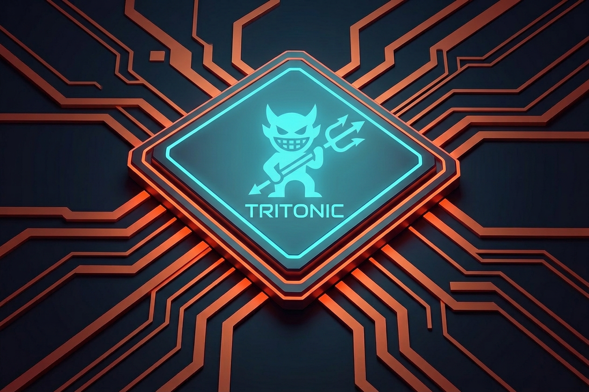

# TritonIC — C++ Inference Client

[](https://github.com/olibartfast/tritonic/actions/workflows/ci.yml)
[](https://en.cppreference.com/w/cpp)
[](https://cmake.org/)
[](https://github.com/olibartfast/tritonic/releases/tag/v0.5.0)

A C++20 client for computer vision on the
[NVIDIA Triton Inference Server](https://github.com/triton-inference-server/server)
(detection, segmentation, classification, pose, depth, optical flow, video classification)
over HTTP or gRPC. It also works with any OpenAI-compatible `/v1/chat/completions`
endpoint, for VLMs and LLMs.

Give it a model on Triton, an image or a video, and a labels file. It runs the model's
preprocessing, inference and postprocessing, and writes back an annotated file.

**Start here, then go deeper:** this page is the short path: build, start Triton, run.
[docs/usage.md](docs/usage.md) is the full command-line reference.
[docs/models.md](docs/models.md) lists every supported model and its `--model_type`.
The rest is indexed in **[docs/README.md](docs/README.md)**.

---

## Table of Contents
- [Quick Start](#quick-start): from a clean Ubuntu box to an annotated image
- [Running It](#running-it): images, video, GPU ensembles, chat
- [Common Flags](#common-flags)
- [Choosing Where Preprocessing Runs](#choosing-where-preprocessing-runs)
- [Versions at a Glance](#versions-at-a-glance)
- [Common Build Options](#common-build-options)
- [Documentation](#documentation)
- [Testing](#testing)
- [References](#references)

---

## Quick Start

Five steps on Ubuntu. You need Docker and, for a GPU server, the
[NVIDIA Container Toolkit](docs/guides/Docker_setup.md).

### 1. Install the toolchain

```bash
sudo apt-get update
sudo apt-get install -y cmake ninja-build g++ libopencv-dev rapidjson-dev \
  libcurl4-openssl-dev libprotobuf-dev protobuf-compiler
```

### 2. Get the Triton client libraries

```bash
./docker/scripts/extract_triton_libs.sh
export TritonClientBuild_DIR=$(pwd)/triton_client_libs/install
```

This copies the prebuilt libraries out of the pinned `tritonserver:<tag>-py3-sdk` image.
To build them from source instead, see [docs/building.md](docs/building.md#build-client-libraries).

### 3. Build

```bash
cmake -S . -B build -G Ninja -DCMAKE_BUILD_TYPE=Release
cmake --build build --parallel
```

[neuriplo-tasks](https://github.com/olibartfast/neuriplo-tasks), which does the model
pre- and postprocessing, is fetched automatically.

### 4. Serve a model

Export a detector and put it in a Triton model repository:

```bash
pip install ultralytics
yolo export model=yolo11s.pt format=onnx              # -> yolo11s.onnx
mkdir -p model_repository/yolo11s_onnx/1
mv yolo11s.onnx model_repository/yolo11s_onnx/1/model.onnx
./docker/scripts/docker_triton_run.sh "$PWD/model_repository" 26.08 gpu   # or: cpu
```

Exports for every other model family are linked from [docs/models.md](docs/models.md).

### 5. Run

```bash
./build/tritonic --source=data/images/bus.jpg --model_type=yolo \
  --model=yolo11s_onnx --labelsFile=labels/coco.txt
```

Detections are printed to the console. The annotated image is written to
`data/images/output/processed_frame_yolo11s_onnx.jpg`, an `output/` directory next to the
source. Videos are written to `processed_<model>.avi` in the same directory.

---

## Running It

`--model_type` selects the model's pre- and postprocessing, and `--model` names the model on Triton.
Images and videos use the same command line.

```bash
# Object detection on an image (HTTP, localhost:8000 by default)
./build/tritonic --source=data/images/bus.jpg --model_type=yolo26 \
  --model=yolo26det_trt --labelsFile=labels/coco.txt

# Video over gRPC
./build/tritonic --source=video.mp4 --model_type=yolo26 --model=yolo26det_trt \
  --labelsFile=labels/coco.txt --protocol=grpc --port=8001

# Send the JPEG and let a Triton ensemble decode and preprocess it on the GPU (DALI)
./build/tritonic --source=data/images/bus.jpg --model_type=yolo26 \
  --model=yolo26det_gpu_pre_cpu_post --task_model=yolo26det_trt \
  --labelsFile=labels/coco.txt --input_mode=encoded-image

# Chat backend: any OpenAI-compatible server, no Triton needed
./build/tritonic --backend=chat --api_endpoint=http://localhost:11434/v1/chat/completions \
  --model=gemma3:4b --text_prompt="Describe this image" --source=data/images/bus.jpg
```

Segmentation, pose, optical flow (`img1.jpg,img2.jpg`), video classification, and the chat
REPL (`--interactive`) are covered in [docs/usage.md](docs/usage.md). To run TritonIC in a
container without building it, see [docs/Docker_Scripts.md](docs/Docker_Scripts.md).

---

## Common Flags

| Flag | Default | Effect |
|------|---------|--------|
| `--source` | — | Image, video, or comma-separated image pair |
| `--model_type` | — | Pre/postprocessing family, e.g. `yolo`, `yolo26`, `rfdetr`, `yolo26seg` ([all tags](docs/models.md#model-type-tags)) |
| `--model` | — | Model name on the Triton server |
| `--labelsFile` | — | Class names, one per line |
| `--protocol` / `--serverAddress` / `--port` | `http` / `localhost` / `8000` | Server endpoint (gRPC uses `8001`) |
| `--input_mode` | `preprocessed` | `encoded-image` sends the JPEG to a GPU ensemble (needs `--task_model`) |
| `--postprocess_mode` | `cpu` | `gpu` for ensembles with a GPU postprocess step |
| `--shared_memory_type` | `none` | `system` or `cuda` shared memory between client and server |
| `--preprocess_device` | `cpu` | `cuda` preprocesses on the client GPU (CUDA build, same host as Triton) |
| `--confidence_threshold` | `0.5` | Minimum confidence for a detection |
| `--backend` | `triton` | `chat` for OpenAI-compatible endpoints |

Every flag is listed in **[docs/usage.md](docs/usage.md#command-line-flags)**.

> [!NOTE]
> Since Triton 26.08 the server refuses client shared memory unless it runs with
> `--allow-client-shm=true`. With the run script, set `ALLOW_CLIENT_SHM=true`.

---

## Choosing Where Preprocessing Runs

For YOLO26 detection, four placements were measured on an NVIDIA A10G with Triton 26.08.
The numbers are the mean client latency per request over gRPC
([full report](specs/2026-10-01-gpu-preprocess-alternatives/evidence/2026-10-09-brev-a10g/comparison.md)).

| Placement | How | Latency | Use when |
|-----------|-----|---------|----------|
| **Client CPU** (default) | plain build, `--input_mode=preprocessed` | 27.0 ms | Any client, including CPU-only machines |
| **Triton + DALI** | `--input_mode=encoded-image` with a `*_gpu_pre_*` ensemble | 9.3 ms | **Recommended server-side default**: remote clients sending JPEG. Best at large images (162 infer/s at 1080p). |
| **Triton + custom CUDA backend** | `yolo26det_cudapre_*` ensembles | 11.2 ms | Deployments that must avoid DALI. Bit-exact with DALI and faster on images under about 1 MP. |
| **Client GPU** | `-DTRITONIC_ENABLE_CUDA=ON`, `--preprocess_device=cuda --shared_memory_type=cuda` | 3.1 ms | Client and Triton on the same GPU host |

A CUDA-enabled build still runs on CPU-only machines with the default
`--preprocess_device=cpu`. Setup for each option is in the
[YOLO26 detection ensemble guide](deploy/object_detection/yolo26/ensemble/README.md).

---

## Versions at a Glance

> **Every version below is pinned once, in [`versions.env`](versions.env).** CMake reads it
> through `cmake/versions.cmake` and the shell scripts through `scripts/versions.sh`. Any pin
> can be overridden without editing the file (`cmake -DNEURIPLO_TASKS_VERSION=…`,
> `TRITON_IMAGE=… ./docker/scripts/docker_triton_run.sh …`). `./scripts/check_version_sync.sh`
> (run in CI) fails when a file that cannot read it drifts.

| Component | Version | Needed for |
|-----------|---------|-----------|
| C++ compiler | GCC 12+ or Clang 15+ (C++20) | everything |
| CMake | 3.20+ | everything |
| **Triton server and client libraries** | **26.08** (`tritonserver:26.08-py3`, client `r26.08`) | inference server, client build |
| **neuriplo-tasks** | **v0.8.2** (auto-fetched) | model pre/postprocessing |
| TensorRT | 11.2.1.2 (in `tensorrt:26.08-py3`) | building `.engine` / `.plan` models |
| NVIDIA DALI | 2.2.0 (in `tritonserver:26.08-py3`) | GPU preprocessing ensembles |
| CUDA Toolkit | 13.3 series | `-DTRITONIC_ENABLE_CUDA=ON`, custom backend |
| OpenCV | 4.x (system) | image/video I/O |
| GoogleTest | 1.14.0 (auto-fetched) | tests |

---

## Common Build Options

| Option | Default | Effect |
|--------|---------|--------|
| `-DCMAKE_BUILD_TYPE=Release/Debug` | — | Use `Release` for any timing |
| `-DWITH_SHOW_FRAME=ON/OFF` | `OFF` | Show frames in a window during inference |
| `-DWITH_WRITE_FRAME=ON/OFF` | `ON` | Write annotated frames/video to disk |
| `-DWITH_CHAT_BACKEND=ON/OFF` | `ON` | OpenAI-compatible chat backend |
| `-DTRITONIC_ENABLE_CUDA=ON/OFF` | `OFF` | Client-side CUDA preprocessing; needs the CUDA Toolkit at build time only |
| `-DBUILD_TESTING=ON/OFF` | `OFF` | Unit and integration tests |
| `-DTRITONIC_STRICT_WARNINGS=ON/OFF` | `OFF` | Strict warnings, as in CI |

Dependencies, client-library builds and pre-commit hooks are covered in
[docs/building.md](docs/building.md).

---

## Documentation

| Document | Covers |
|----------|--------|
| **[docs/usage.md](docs/usage.md)** | Every flag, shared memory, GPU ensembles, segmentation output, Docker scripts, chat backend |
| **[docs/models.md](docs/models.md)** | Supported models, `--model_type` tags, export instructions |
| **[docs/building.md](docs/building.md)** | Dependencies, Triton client libraries, build options, version pins, tests |
| **[docs/deployment.md](docs/deployment.md)** | Model repositories, starting Triton, Docker image, Kubernetes |
| **[docs/architecture.md](docs/architecture.md)** | Project layout, Triton and chat backends |
| **[docs/README.md](docs/README.md)** | Index of all guides, per-model deployment guides and benchmarks, roadmaps |
| [AGENTS.md](AGENTS.md) | Code structure and conventions for contributors |
| [CHANGELOG.md](CHANGELOG.md) | Released changes |

---

## Testing

```bash
cmake -S . -B build -G Ninja -DCMAKE_BUILD_TYPE=Release -DBUILD_TESTING=ON
cmake --build build --parallel
ctest --test-dir build --output-on-failure
```

Unit tests use mocked Triton and chat backends, so they need no server or GPU.
CI (`.github/workflows/ci.yml`) runs the version-sync and format checks, cppcheck, a
strict-warnings build and the tests. GPU paths are validated separately with
[`run_gpu_host_gate.sh`](integration-tests/gpu-preprocess/run_gpu_host_gate.sh)
([runbook](specs/2026-10-01-gpu-preprocess-alternatives/gpu-validation-runbook.md)).

---

## References

- [Triton User Guide](https://docs.nvidia.com/deeplearning/triton-inference-server/user-guide/docs/getting_started/quickstart.html)
  · [Release notes](https://docs.nvidia.com/deeplearning/triton-inference-server/pdf/Triton-Inference-Server-Release-Notes.pdf)
  · [Tutorials](https://github.com/triton-inference-server/tutorials)
  · [Client example](https://github.com/triton-inference-server/client/blob/r21.08/src/c%2B%2B/examples/image_client.cc)
- Demos (RTX 3060): [YOLOv7-tiny](https://youtu.be/lke5TcbP2a0) ·
  [YOLO11s](https://youtu.be/whP-FF__4IM) ·
  [RAFT optical flow](https://www.youtube.com/watch?v=UvKCjYI_9aQ)
- Feedback, bug reports and contributions are welcome via
  [issues](https://github.com/olibartfast/tritonic/issues).
